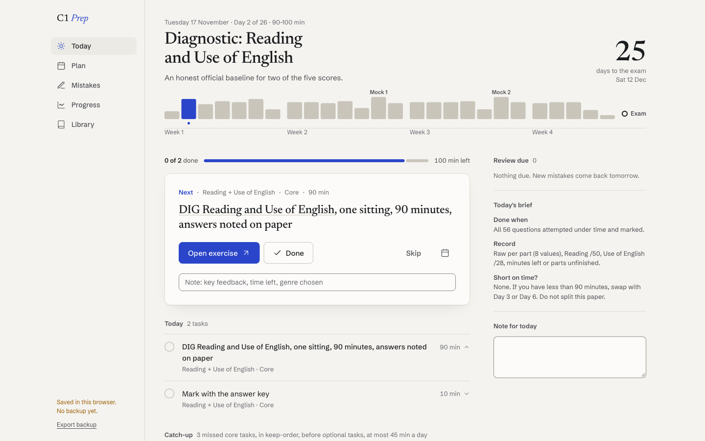

# Cambridge C1 Advanced Preparation Tracker

**Live App:** [Open Cambridge C1 Tracker](https://c1-cambridge-tracker.vercel.app)

A personal web app for preparing for the Cambridge C1 Advanced English exam: what to study each day, what you got wrong, and how your scores are moving.

### Preview



### Features

- Daily study plan with task tracking
- 26-day preparation schedule, including two full mock exams
- Mistake notebook with spaced-repetition review
- Exam score and progress tracking
- Curated free resources and ChatGPT tutor prompts
- Light and dark mode, with progress saved locally

### How to use

1. Open the [live application](https://c1-cambridge-tracker.vercel.app).
2. Follow the daily preparation tasks on **Today**.
3. Mark exercises complete and record your results.
4. Review mistakes and track your progress.
5. Export a backup occasionally (Library > Export JSON).

Progress is saved in your browser's local storage. It is not synchronised between devices or browsers; use Export and Import to move it.

### Run locally

```bash
cd app
npm install
npm run dev
```

Built with React, TypeScript, Vite and Tailwind CSS.
